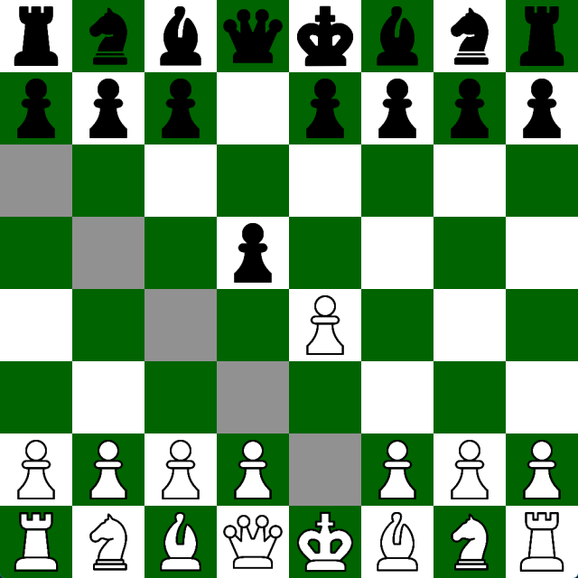

# Échecs – apprendre les déplacements en jouant

Application de bureau pour apprendre à jouer aux échecs : quand on sélectionne une pièce, **les cases où elle peut aller sont surlignées**. On apprend ainsi les déplacements de chaque pièce en jouant, sans avoir à connaître les règles à l'avance.



Projet personnel, réalisé seul depuis juin 2026, en cours.

## Fonctionnalités

- Plateau 8 × 8 avec les 32 pièces en position de départ.
- Sélection d'une pièce et **affichage des cases accessibles**, selon les règles de chaque pièce (pion, tour, cavalier, fou, dame, roi).
- Prises et alternance des tours entre les blancs et les noirs.
- Premier déplacement du pion de deux cases.
- **Promotion du pion** : arrivé au bout du plateau, un menu propose de le transformer en dame, tour, fou ou cavalier ; la partie est bloquée tant que le choix n'est pas fait.

Pas encore gérés : l'échec et le mat, le roque, la prise en passant.

## Technologies

- C# / .NET 10
- WPF (contrôles utilisateur, images embarquées en ressources)

## Organisation du code

| Dossier / fichier | Rôle |
|---|---|
| `Moteur.cs` | État de la partie (singleton) : grille, joueur actuel, pièce sélectionnée, déroulement d'un coup |
| `Pieces/` | Une classe par pièce, qui hérite de `Piece` et redéfinit `RecupererListeCasesDisponibles()` |
| `Controls/` | Contrôles WPF du plateau et des cases, menu de promotion |
| `Helper/PlateauHelper.cs` | Navigation dans la grille (case voisine dans chaque direction), surlignage, déplacement |
| `Enums/` | Couleur des joueurs, choix de promotion |

Chaque pièce ne décrit que **sa propre règle de déplacement** : ajouter une pièce ou corriger une règle ne touche qu'un seul fichier.

## Lancer le projet

Prérequis : Windows et le [SDK .NET 10](https://dotnet.microsoft.com/download).

```powershell
git clone https://github.com/MathisLABBE/Echecs.git
cd Echecs
dotnet run --project Echecs
```

Ou ouvrir `Echecs.slnx` dans Visual Studio 2026 et lancer le projet.

## Avec le recul

- Les règles du jeu sont écrites dans les contrôles WPF (`Piece` hérite de `UserControl`). Les séparer de l'affichage (MVVM) permettrait de les **tester automatiquement**, pièce par pièce.
- La détection de l'échec demandera de simuler un coup sans l'afficher : c'est la prochaine étape, et la meilleure raison de faire cette séparation.

## Auteur

Mathis LABBE – étudiant en BUT Informatique en alternance · [GitHub](https://github.com/MathisLABBE) · [LinkedIn](https://www.linkedin.com/in/mathis-labbe-92518131b/)
